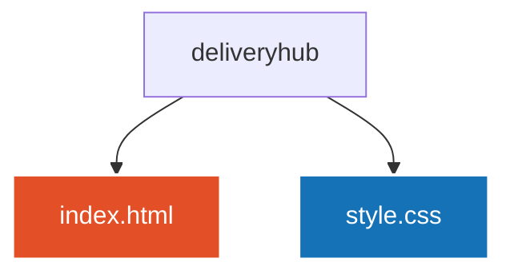

# DeliveryHub 🍔🛵


[](https://alicesilva2012.github.io/deliveryhub/)

> Uma landing page responsiva e interativa para uma hamburgueria artesanal, com cardápio em destaque, provas sociais e botões de pedido direto via WhatsApp.

> [!IMPORTANT]
> **Projeto Fictício (Estudo & Portfólio):** O **DeliveryHub** não é um estabelecimento real, nenhum produto está à venda e o número de WhatsApp vinculado aos botões é meramente ilustrativo para demonstração de redirecionamento.

---

## 💻 Sobre o Projeto

O **DeliveryHub** é uma aplicação front-end criada com o objetivo de apresentar o cardápio de uma hamburgueria artesanal de forma atraente, intuitiva e direta. Através de um layout focado em experiência do usuário (UX/UI), os visitantes podem visualizar fotos dos pratos, preços, selos de destaque, métricas de atendimento e iniciar pedidos diretamente pelo WhatsApp.

O projeto conta com navegação rápida por âncoras entre as seções (*Início*, *Cardápio*, *Sobre* e *Contato*), reforçando a identidade visual da marca com selos de garantia e depoimentos.

---

## ⚙️ Funcionalidades

- **Navegação Fluida por Âncoras:** Links rápidos no menu superior para navegar suavemente entre as seções (`#home`, `#cardapio`, `#sobre`, `#contato`).
- **Métricas de Impacto:** Seção de destaque com provas sociais (`+500 Clientes`, `Avaliação 4.8`, `Garantia de 40min`).
- **Cardápio Estilizado com Badges:** Apresentação visual dos pratos com preços e etiquetas de destaque (*Mais vendido*).
- **Integração com WhatsApp:** Botões de ação (CTA) que redirecionam para o WhatsApp com mensagem de pedido pré-preenchida.
- **Seção "Nossa História":** Apresentação dos pilares do restaurante (carne selecionada, entrega rápida e pagamento facilitado).
- **Informações Institucionais:** Rodapé completo com horários de funcionamento, telefone, endereço e redes sociais.

---

## 📊 Cardápio em Destaque

Abaixo está uma amostra dos principais itens apresentados no cardápio do DeliveryHub:

| Item | Descrição | Preço | Destaque |
| :--- | :--- | :---: | :---: |
| **Hambúrguer Clássico** | Pão brioche, carne bovina, cheddar, alface, tomate, picles e molho | R$ 22,90 | 🔥 Mais vendido |
| **X-Bacon** | Pão artesanal, carne bovina, fatias de bacon, queijo e maionese | R$ 24,90 | 🔥 Mais vendido |
| **X-Salada** | Pão de hambúrguer, carne bovina, queijo, alface e tomate | R$ 20,99 | — |
| **CheeseBurger** | Pão de hambúrguer, carne bovina e queijo cheddar | R$ 19,90 | — |
| **Batata Frita + Cheddar e Bacon** | Batatas crocantes com cheddar cremoso e bacon | R$ 15,50 | 🔥 Mais vendido |
| **Milkshake de Chocolate** | Milkshake cremoso de chocolate com calda especial | R$ 14,90 | — |

---

## 🛠️ Tecnologias Utilizadas

- **HTML5:** Estruturação semântica e acessível utilizando `<header>`, `<nav>`, `<section>`, `<article>`, `<figure>` e `<footer>`.
- **CSS3:** 
  - Layouts responsivos construídos com **Flexbox** e **CSS Grid**.
  - Rolagem suave (`scroll-behavior: smooth`), tipografia personalizada e microinterações de `:hover` nos cards e botões.
- **WhatsApp Click to Chat (`wa.me`):** Redirecionamento direto com parâmetros de texto codificados na URL.

---

## 🌎 Teste meu projeto no seu navegador!

- **DeliveryHub:** [VEJA ESTE PROJETO NO SEU NAVEGADOR!](https://alicesilva2012.github.io/deliveryhub/)

---

## 🚀 Como Executar o Projeto Localmente

### Pré-requisitos
- Um navegador web moderno (Google Chrome, Firefox, Edge, etc.).
- [Git](https://git-scm.com) instalado na máquina.
- Um editor de código como o [VS Code](https://code.visualstudio.com/) (opcional).

### ☕ Passo a Passo

1. **Clone este repositório:**
   ```bash
   git clone https://github.com/AliceSilva2012/deliveryhub.git
   ```

2. **Acesse a pasta do projeto:**
   ```bash
   cd deliveryhub
   ```

3. **Execute a aplicação:**

   - Dê um duplo clique no arquivo index.html para abri-lo no navegador, ou
   - Clique com o botão direito no index.html e selecione Open with Live Server.

---

## 📁 Estrutura de Arquivos


